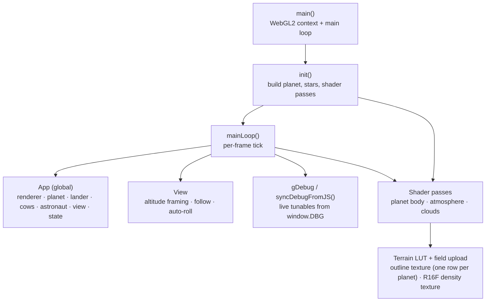

# Core / game loop

`main.cpp` is the orchestrator. It owns the single global `App`, wires up the
WebGL context, runs the per-frame `mainLoop`, and defines all the fullscreen
GLSL shader passes inline (their string sources live here, not in the graphics
layer). It also owns the `View` camera and the `gDebug` tunables.

## Responsibilities

- **App singleton** — aggregates every subsystem object: the `Renderer2D`, the
  generated planet vector and its `StarSystem` metadata (`dominantIdx` picks
  the body with the strongest pull at the ship for camera/contact/beam,
  `activeFieldIdx` tracks the one live destructible field, `stuckIdx` is the
  body a landed or wrecked ship rides along with), the `Lander`, the cow herd, the
  `Astronaut`, the `View`, plus GL handles for the shader passes, the
  starfield, cargo/score, and timing.
- **State machine** — `GameState` is `PLAYING`, `LANDED`, or `CRASHED`.
  `updateContact()` judges ground contact as a safe landing (slow + upright +
  flat, via `terrainFlat()`/`pointInTriangle()`) or a crash. Edge-triggered keys
  handle lift-off (thrust from `LANDED`), restart (R from `CRASHED`), and exit/
  enter ship (E toggles the spacewalking astronaut).
- **Moving frames** — every planet is travelling along its orbit at tens of
  units per frame, so anything "at" a world is simulated relative to it: the
  ship spawns and lifts off with the body's `orbitVel`, atmospheric drag pulls
  toward the air's velocity (its planet's), a landed/wrecked ship is pinned to
  `center + landingOffset`, cows and the astronaut are carried by `orbitStep`
  before their own ground-relative update, and the HUD speed is relative to
  the dominant body.
- **Camera (`View`)** — `matrix()` composes world→clip with +y down. `updateView`
  uses one framing rule from the ground to deep space: hold `cameraGroundZoom`
  while low (1.8 px per world unit by default — the astronaut and ship at
  about a twelfth of the screen height), then pull back just fast enough that
  the ground (true terrain under the player, averaged over ~1400 units) stays
  `cameraFraming` screen-heights below — so the horizon never leaves the frame
  during a climb or descent. A **speed look-ahead** (`cameraSpeedLook`
  seconds) also caps the zoom so that much travel at the current speed fits
  on screen: close while standing or walking, wide while the ship moves fast
  near the ground. Near the ground the focus is lifted (`cameraHorizon`) so the
  horizon sits on the lower third. Velocity-predictive follow, plus an
  auto-roll that keeps the dominant body's gravity pointing screen-down.
  `updateZoom` layers manual scroll/key zoom on top. **M** switches to the
  system map (frames every orbit around the star, levels the roll).
- **Navigation aids** — `drawTrajectory` predicts the coast path with the
  planets advancing along their orbits (`Lander::predictTrajectory`) and draws
  it in the frame of whichever body pulls hardest (a planet's frame near a
  world, the star's in open space); a dashed ghost ring marks where another
  world will be at closest approach. `drawNavOverlay` fades in when the view
  is far out: orbit rings, marker discs for worlds too small to see, and DOM
  name labels. `updateDiscovery` charts worlds on approach (+25) and
  `updateContact` scores first landings (+100).
- **Hand tool** — on foot, holding the mouse button fires the tool at the
  cursor; Q switches its mode. **Terrain cutter:** the beam runs from head
  height toward the cursor and bites the first rock it meets, a small circle
  (`CUT_RADIUS`) set almost wholly on the near side of the face so each bite
  shaves `CUT_BITE` off it — hold it and the hole deepens steadily; every few
  bites yield a ferrite, anything growing on the cut ground is uprooted, and
  it will not cut under the ship. It aims at what the cursor is drawn over
  (dug space is drawn `WALK_DROP` below where it is), collapses a roof too
  thin to stand, and leaves heat behind: the last dozen bites are kept in
  `App::burns` (cooling in under two seconds) for the body shader's glow, and
  each throws embers and the odd puff of smoke (particle modes 2 and 3). **Inventory:** `App::inventory` counts items
  by id (carbon, ferrite, one crystal per world archetype); `addItem` updates
  it and the page shows the pickup feed and the Tab panel (`setInventory`,
  `notifyPickup` in shell.html). **Mining laser** (`updateLaser`): the cursor is turned into a world point (`screenToWorld`),
  `NearField::pick` finds the harvestable under it within `LASER_RANGE`
  (underground, `CaveField::pick` finds the cave prop — formations, crystals,
  glowcaps, gold — and that is mined the same way; items 9–11), and
  the beam cuts it down (`toughness` beam-seconds) into resource chips that
  fly to the player; counts live in `App::inventory` (carbon / ferrite /
  crystal) and reach the HUD via `updateInventory`. With nothing under the
  cursor the beam goes where it is pointed and lands on the ground in front
  of or behind the walking line. `drawLaserFx` draws the beam (tapered by the
  target's depth, so it reads as leaving or entering the screen), impact,
  particles and the brackets around a targetable item. **It must run after
  `updateView`**: the cursor is unprojected through the camera, and the world
  moves ~60 units a frame, so last frame's view puts the beam that far off.
- **Fullscreen shader passes** — GLSL sources and their draw calls are defined
  here: the **planet body** (fills rock from the R16F density-field texture
  with fwidth-smoothed iso-line edges, altitude-banded material, slope lighting
  from the SDF gradient, the merged day/night terminator, and holes and
  caves drawn as a darker shade of the ground they are cut in — `holeShade`,
  deeper is darker down to `holeFloor`, tuned by the `holeFloor` /
  `holeDepth` knobs), the **atmosphere** (Rayleigh/Mie scattering disk),
  and the **clouds** (FBM density band). All reconstruct the world point under
  each pixel from the camera transform and share a `sunWorldPos()` light. An
  R32F **terrain LUT texture** (one row per planet, as wide as
  `Planet::LUT_N` — 8192 — or the GPU's limit) feeds them the per-angle
  silhouette. For the planet you are on, the ground itself is drawn from the
  density grid, not from that table, and the two only agree to within a unit
  or two (a table of straight runs against a grid's curved 0 line; worst on
  steep slopes). So the open-sky band is drawn `SKY_UNDERLAP` units *under*
  the table's line and the ground covers it — a sky that stopped on the line
  left black slivers, with stars in them, between sky and ground; the body pass also samples the
  carve texture (what has been dug) and takes the minimum, and a bite
  re-uploads just its dirty rect (`uploadCarveRegion`). Dug space is drawn
  `NearField::WALK_DROP` below where it physically is, so holes open at the
  walking line and their floors meet the boots drawn on them; the mouth is
  shaped into an ellipse (`MOUTH`, `MOUTH_RISE`, `MOUTH_ROUND`) from how far
  a column is inside the hole at ground level. The pass runs a second time
  after the player is drawn (`drawBodyPass(BodyPass::Veil)`) to lay the **front
  ground** back over dug space, from the mouth's near rim down. `cover` in
  the shader says how solidly: completely while the player is on the surface
  (a hole is only its mouth), and as a cutaway while they are down one
  (`App::inHole`, eased) — see-through across the front strip near them, open
  below it. The same value hides the scorch on a hole's walls from the
  surface. Rock within a few units of a cut is scorched, and glows where
  `u_burn` says the cutter has just been. One light model
  (`LIGHT_GLSL` in the shaders, `groundLight()` on the CPU) grades day into
  dusk into night for the ground, clouds, ridges, plants and foreground. Every pass takes
  per-planet uniform arrays filled from `PlanetLook` (terrain tones, sky
  scatter colors + gain, haze color, cloud cover + colors), which is all that
  distinguishes one world's rendering from another's. The atmosphere pass also
  adds the **horizon haze** band (a pale glow in the lowest slice of air) and
  fades the shell out over its top stretch so the limb is a soft glow from
  altitude. CPU-side helpers draw the **ridge silhouettes** behind the body,
  **blob shadows** under entities, the **sky dome** (`drawSkyBodies`: the
  star and the other worlds at their true directions, rising and setting
  behind the terrain), and the screen-anchored **foreground band**
  (`drawForeground`).
- **Live tunables** — `syncDebugFromJS()` pulls `window.DBG` sliders into the
  `gDebug` struct each frame (see [debug.h](../../src/core/debug.h)); the
  gravity knob is re-applied (to every body, followed by `updateKeplerSpeeds`)
  only when it changes. The sun-angle override pins the world you're at on
  its orbit at the angle that puts the star in the requested direction. The
  panel stores only sliders that differ from their default, and
  `SUPERSEDED` in shell.html lists replaced defaults so a stale stored copy
  of one doesn't mask a new default.
- **HUD** — pushes fuel/altitude/speed/cargo/score to the DOM overlay via
  `EM_ASM(window.updateHUD(...))`, the current world / system / chart progress
  via `updateNav` (only on change), and event banners via `showEvent`.
- **Dev hooks** — `Module._debugWarpTo(i)` drops the ship above body `i` (the
  debug panel's "Warp to" buttons); `Module._debugWarpAngle(i, angle,
  altitude)` does the same above a chosen point of its surface, for looking
  at one piece of terrain; `Module._debugDump()` snapshots the simulation
  into `window.GAME_DUMP`; `Module._debugDigShaft(angle, depth, radius)`
  cuts a straight shaft with the cutter's bites (for testing how holes look
  at a known depth).
- **Screen-space passes must flush themselves** — `Renderer2D::begin()` clears
  the batch without drawing it, so a pass that only calls
  `beginScreenSpace()` and leaves geometry pending has it discarded by the
  next `begin()`. Wrap screen-space draws in their own `begin()`/`end()`.

The per-frame ordering is documented separately in
[the frame loop](../flows/frame-loop.md).

## Source

- [src/core/main.cpp](../../src/core/main.cpp) — entry point, `App`, `View`,
  game-state machine, all inline shader passes, the main loop, and HUD/debug
  bridging.
- [src/core/debug.h](../../src/core/debug.h) — the `gDebug` struct of live,
  in-game-tunable knobs (the C++ twin of the original game's `DEBUG` object).

## Related

- Render-pass ordering and the update sequence: [frame loop](../flows/frame-loop.md).
- The objects the loop drives: [entities](entities.md), [world](world.md).
- The renderer the 2D draws batch into: [graphics](graphics.md).
