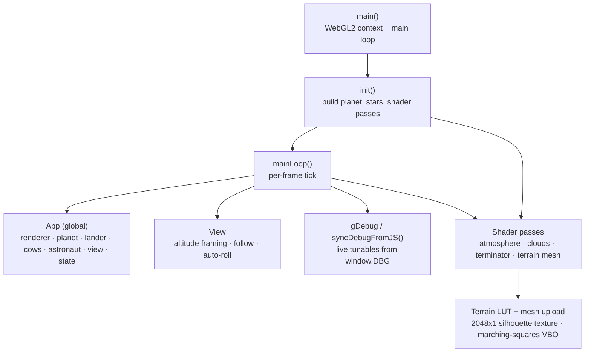

# Core / game loop

`main.cpp` is the orchestrator. It owns the single global `App`, wires up the
WebGL context, runs the per-frame `mainLoop`, and defines all the fullscreen
GLSL shader passes inline (their string sources live here, not in the graphics
layer). It also owns the `View` camera and the `gDebug` tunables.

## Responsibilities

- **App singleton** — aggregates every subsystem object: the `Renderer2D`, the
  `Planet`, the `Lander`, the cow herd, the `Astronaut`, the `View`, plus GL
  handles for the shader passes, the starfield, cargo/score, and timing.
- **State machine** — `GameState` is `PLAYING`, `LANDED`, or `CRASHED`.
  `updateContact()` judges ground contact as a safe landing (slow + upright +
  flat, via `terrainFlat()`/`pointInTriangle()`) or a crash. Edge-triggered keys
  handle lift-off (thrust from `LANDED`), restart (R from `CRASHED`), and exit/
  enter ship (E toggles the spacewalking astronaut).
- **Camera (`View`)** — `matrix()` composes world→clip with +y down. `updateView`
  does altitude-based framing (split at the atmosphere boundary), velocity-
  predictive follow, and an auto-roll that keeps net gravity pointing screen-down.
  `updateZoom` layers manual scroll/key zoom on top.
- **Fullscreen shader passes** — GLSL sources and their draw calls are defined
  here: the **atmosphere** (Rayleigh/Mie scattering disk), the **clouds** (FBM
  density band), the **terminator** (day/night multiply darkening), and the
  **terrain** mesh (marching-squares planet body). All reconstruct the world
  point under each pixel from the camera transform and share a `sunWorldPos()`
  light. A 2048×1 R32F **terrain LUT texture** feeds them the per-angle
  silhouette so sky, clouds, and ground line up exactly.
- **Live tunables** — `syncDebugFromJS()` pulls `window.DBG` sliders into the
  `gDebug` struct each frame (see [debug.h](../../src/core/debug.h)); planet
  density is re-applied only when it changes.
- **HUD** — pushes fuel/altitude/speed/cargo/score to the DOM overlay via
  `EM_ASM(window.updateHUD(...))`.

The per-frame ordering is documented separately in
[the frame loop](../flows/frame-loop.md).

## Source

- [src/core/main.cpp](../../src/core/main.cpp) — entry point, `App`, `View`,
  game-state machine, all inline shader passes, the main loop, and HUD/debug
  bridging.
- [src/core/debug.h](../../src/core/debug.h) — the `gDebug` struct of live,
  in-game-tunable knobs (the C++ twin of the original game's `DEBUG` object).

## Related

- Render-pass ordering and the update sequence: [frame loop](../flows/frame-loop.md).
- The objects the loop drives: [entities](entities.md), [world](world.md).
- The renderer the 2D draws batch into: [graphics](graphics.md).
