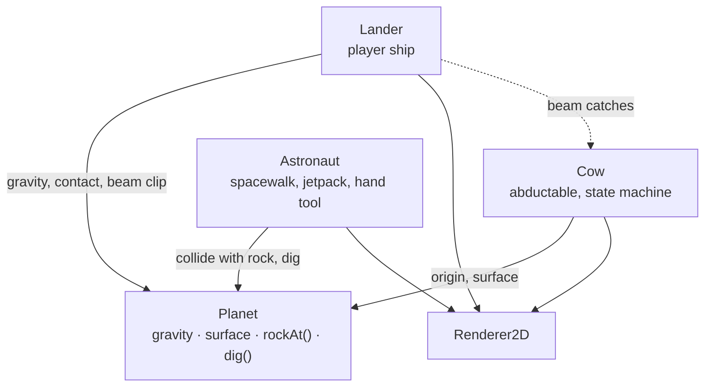

# Entities

The three gameplay actors. All live in planet world-space, read gravity and the
surface silhouette from the [Planet](world.md), and draw themselves through the
[Renderer2D](graphics.md). They are forward-simulated by the
[core loop](core.md) each frame.

## Responsibilities

- **Lander** — the player ship. 1/r² gravity, thrust along the local "up",
  multiplicative atmospheric drag with substepping, and a velocity clamp
  (ported from `lander.js`). Owns the tractor-beam cone (`updateBeam` builds a
  terrain-clipped triangle used for both rendering and catch tests), the
  landing/crash/lift-off transitions, and `predictTrajectory()` for the coast
  path drawn in space. Touchdown is judged with the ship's center still a
  radius above the ground line, about 20 units above where a parked ship
  rests (base sunk onto its shadow), so `land()` doesn't teleport it there:
  `settle()` carries the approach speed down on a damped spring (a firm
  landing dips a little past rest), runs off any sideways speed as a short
  slide and eases the hull upright. `liftOff()` rises from where the ship
  sits; contact isn't judged again until it climbs clear or sinks back. The core loop reads `gravityAt()` for the camera roll.
- **Cow** — runs a small state machine: `OnGround` (wobbles back toward its
  origin) → `Carried` (reeled up the beam, capped speed because it's heavy) →
  `Falling` (released, under gravity) → `Stowed` (reached the hatch; the frame
  it stows, `update()` returns true so the loop bumps cargo + score). The beam
  catch test lives in the core loop (`runBeamGrab`/`pointInTriangle`). A cow
  also falls when the ground under it is cut away, and it lands on whatever
  rock is below (`Planet::rockAt`) — so it drops to the floor of a hole. The
  herd is updated while the ship is parked as well as in flight
  (`updateCows`), since on foot is when you dig.
- **Astronaut** — the out-of-ship character: walks along the surface, jumps,
  and flies a fuel-limited jetpack. It **collides with the rock itself**
  (`Planet::rockAt`, the terrain minus everything dug): a small probe at the
  feet and a larger one for chest and helmet are each pushed out along the
  surface normal, so it can stand in a hole, walk into a tunnel and bump its
  head on the roof. Standing still pins it in place (no creep down slopes);
  a walker steps down onto ground that falls away gently; A/D steer gently in
  the air (enough to drift out of a shaft under the jetpack). Its hand tool
  (aimed with the mouse, driven by the core loop) is the mining laser or the
  terrain cutter. Spawned/recalled by pressing E near the landed ship. Simulated in the body's co-moving frame
  (the loop carries it by the planet's `orbitStep`). Thrusting breaks ground
  contact, so the jetpack lifts off from a standstill. Top running speed and
  jump take-off speed are live knobs (`walkSpeed` 2.4 units/frame ≈ four body
  lengths a second, `jumpSpeed` 3.0 ≈ 1.2 body heights on the home world);
  ground friction is applied per unit of time, so both are the same at any
  frame rate, and the run cycle advances by ground covered (`STRIDE_CYCLE`).
  **Drawn as flat vector shapes**, not a sprite: a jointed puppet (two-segment
  legs and arms, torso, backpack, helmet) posed every frame in `draw()` from
  blend weights that `update()` eases — `stride` (idle ↔ run cycle), `air`
  (tucked jump, or legs trailing under thrust with the flame out of the
  pack), `aim` (both arms swing onto the line to `aimWorld` and a stubby tool
  appears in the near hand; `draw()` publishes the emitter's world position
  as `muzzleWorld` for the beam).
  Mirrored by `facing`. Palette: off-white suit, one
  shade tone, dark boots/gloves/visor, one orange accent, the ship's teal in
  the visor.

## Source

- [src/entities/lander.h](../../src/entities/lander.h) ·
  [lander.cpp](../../src/entities/lander.cpp) — ship physics, tractor beam,
  landing state transitions, trajectory prediction.
- [src/entities/cow.h](../../src/entities/cow.h) ·
  [cow.cpp](../../src/entities/cow.cpp) — abductable cow state machine and draw.
- [src/entities/astronaut.h](../../src/entities/astronaut.h) ·
  [astronaut.cpp](../../src/entities/astronaut.cpp) — spacewalk movement,
  jetpack, rock collision, and the posed vector figure.

## Related

- Gravity, surface radius, and the destructible crust they act on:
  [world](world.md).
- How they are updated and drawn each tick: [frame loop](../flows/frame-loop.md).
