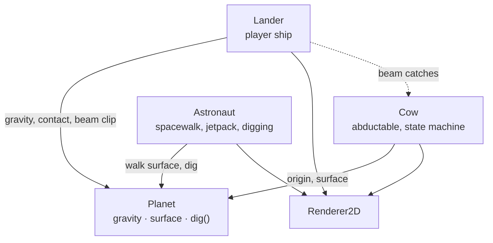

# Entities

The three gameplay actors. All live in planet world-space, read gravity and the
surface silhouette from the [Planet](world.md), and draw themselves through the
[Renderer2D](graphics.md). They are forward-simulated by the
[core loop](core.md) each frame.

## Responsibilities

- **Lander** — the player ship. 1/r² gravity, thrust along the local "up",
  multiplicative atmospheric drag with substepping, and a velocity clamp
  (ported from `lander.js`). Owns the tractor-beam cone (`updateBeam` builds a
  terrain-clipped triangle used for both rendering and catch tests), the
  landing/crash/lift-off transitions, and `predictTrajectory()` for the coast
  path drawn in space. The core loop reads `gravityAt()` for the camera roll.
- **Cow** — runs a small state machine: `OnGround` (wobbles back toward its
  origin) → `Carried` (reeled up the beam, capped speed because it's heavy) →
  `Falling` (released, under gravity) → `Stowed` (reached the hatch; the frame
  it stows, `update()` returns true so the loop bumps cargo + score). The beam
  catch test lives in the core loop (`runBeamGrab`/`pointInTriangle`).
- **Astronaut** — the out-of-ship character: walks along the surface, jumps,
  and flies a fuel-limited jetpack. While spacewalking it can `dig()` the
  crust (the core loop's `doDig()` carves the [TerrainField](world.md) and
  re-uploads the mesh + silhouette LUT). Spawned/recalled by pressing E near
  the landed ship.

## Source

- [src/entities/lander.h](../../src/entities/lander.h) ·
  [lander.cpp](../../src/entities/lander.cpp) — ship physics, tractor beam,
  landing state transitions, trajectory prediction.
- [src/entities/cow.h](../../src/entities/cow.h) ·
  [cow.cpp](../../src/entities/cow.cpp) — abductable cow state machine and draw.
- [src/entities/astronaut.h](../../src/entities/astronaut.h) ·
  [astronaut.cpp](../../src/entities/astronaut.cpp) — spacewalk movement,
  jetpack, and crust digging.

## Related

- Gravity, surface radius, and the destructible crust they act on:
  [world](world.md).
- How they are updated and drawn each tick: [frame loop](../flows/frame-loop.md).
