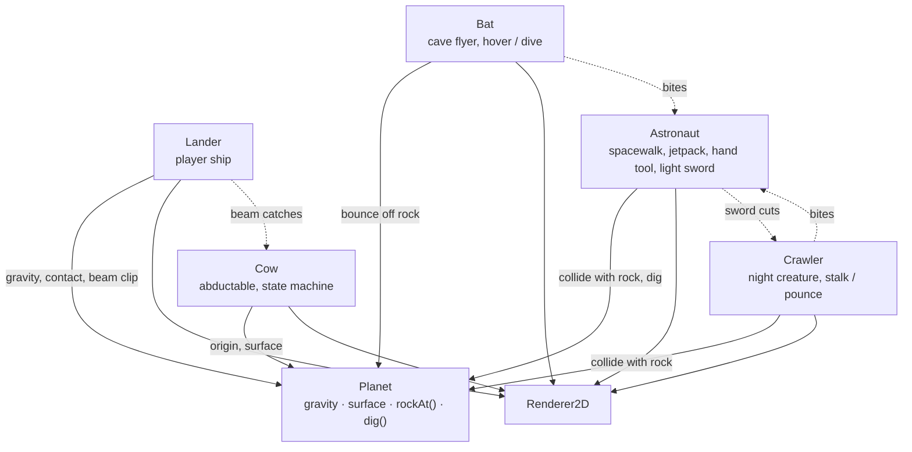

# Entities

The five gameplay actors. All live in planet world-space, read gravity and the
surface silhouette from the [Planet](world.md), and draw themselves through the
[Renderer2D](graphics.md). They are forward-simulated by the
[core loop](core.md) each frame.

## Responsibilities

- **Lander** — the player ship. 1/r² gravity, thrust along the local "up",
  multiplicative atmospheric drag with substepping, and a velocity clamp
  (ported from `lander.js`). Owns the tractor-beam cone (`updateBeam` builds a
  terrain-clipped triangle used for both rendering and catch tests), the
  landing/crash/lift-off transitions (lift-off as a rocket's: `ignite` burns
  on the pad first, then `spool` builds the push from just over the ship's
  weight), and `predictTrajectory()` for the coast
  path drawn in space. Touchdown is judged with the ship's center still a
  radius above the ground line, about 20 units above where a parked ship
  rests (base sunk onto its shadow), so `land()` doesn't teleport it there:
  `settle()` carries the approach speed down on a damped spring (a firm
  landing dips a little past rest), runs off any sideways speed as a short
  slide and eases the hull upright. `liftOff()` rises from where the ship
  sits; contact isn't judged again until it climbs clear or sinks back. The core loop reads `gravityAt()` for the camera roll.
  **It floats.** Water is somewhere to come down, like ground (always
  level): it rests on the surface, `FLOAT_DRAFT` lower than it would stand
  on land, so the water in front laps a third of the way up the hull, and
  rides the swell (`bob`, a drawn-only offset the core loop sets). The
  beam and the predicted path stop at the water too.
- **Cow** — runs a small state machine: `OnGround` (wobbles back toward its
  origin) → `Carried` (reeled up the beam, capped speed because it's heavy) →
  `Falling` (released, under gravity) → `Stowed` (reached the hatch; the frame
  it stows, `update()` returns true so the loop bumps cargo + score). The beam
  catch test lives in the core loop (`runBeamGrab`/`pointInTriangle`). A cow
  also falls when the ground under it is cut away, and it lands on whatever
  rock is below (`Planet::rockAt`) — so it drops to the floor of a hole. The
  herd is updated while the ship is parked as well as in flight
  (`updateCows`), since on foot is when you dig.
- **Astronaut** — the out-of-ship character: walks along the surface, jumps,
  and flies a fuel-limited jetpack. It **collides with the rock itself**
  (`Planet::rockAt`, the terrain minus everything dug): a small probe at the
  feet and a larger one for chest and helmet are each pushed out along the
  surface normal, so it can stand in a hole, walk into a tunnel and bump its
  head on the roof. Standing still pins it in place (no creep down slopes);
  a walker steps down onto ground that falls away gently; A/D steer gently in
  the air (enough to drift out of a shaft under the jetpack). Its hand tool
  (aimed with the mouse, driven by the core loop) is the mining laser or the
  terrain cutter. Spawned/recalled by pressing E near the landed ship. Simulated in the body's co-moving frame
  (the loop carries it by the planet's `orbitStep`). Thrusting breaks ground
  contact, so the jetpack lifts off from a standstill. Top running speed and
  jump take-off speed are live knobs (`walkSpeed` 2.4 units/frame ≈ four body
  lengths a second, `jumpSpeed` 3.0 ≈ 1.2 body heights on the home world);
  ground friction is applied per unit of time, so both are the same at any
  frame rate, and the run cycle advances by ground covered (`STRIDE_CYCLE`).
  **Drawn as flat vector shapes**, not a sprite: a jointed puppet (two-segment
  legs and arms, torso, backpack, helmet) posed every frame in `draw()` from
  blend weights that `update()` eases — `stride` (idle ↔ run cycle), `air`
  (tucked jump, or legs trailing under thrust with the flame out of the
  pack), `aim` (both arms swing onto the line to `aimWorld` and a stubby tool
  appears in the near hand; `draw()` publishes the emitter's world position
  as `muzzleWorld` for the beam), and `swing` (0–1 through a cut of the
  **light sword** at `swingAim`: the near arm carries a glowing blade
  across the line to the target, from 75° above it to 75° below, easing
  out, leaving a fading fan in the player's colour, then straight back to a
  guard). With the sword the tool in hand (`swordOut`) the blade is always
  out, held lit at the guard (arm forward, blade up and forward, the core
  tinted the player's colour); it flares — wider, brighter halo, white-hot
  core, a bloom at the tip — while it cuts, and settles as the arm comes
  back. Drawn, it ignites like a light saber (`blade` 0 → 1 over
  `SWORD_IGNITE`, 0.22 s): a burst at the emitter, the blade shooting out
  fast and slowing to full length with a bright tip running ahead, burning
  bright until it is all the way out; put away, it slides back into the
  hilt (`SWORD_RETRACT`, 0.15 s) before the hilt goes back to the hip. The sword is the hand tool's third mode; the
  swing's timing, what it hits, the hit-stop and the pogo are the core
  loop's (`updateSword`).
  **In water** (`Planet::waterDepth`, measured at the feet: `wet` 0–1)
  the suit is heavy, so it sinks, slowly: the water carries most of its
  weight (`SWIM_BUOYANCY`) and slows everything (`SWIM_DRAG`). It walks
  the bottom as it walks the ground, a little slower, with long floating
  jumps; holding jump swims up (`swim(+1)`: a lift that fades out as the
  chest reaches the surface, so held there it treads water with the head
  out), S dives, A/D swim along at about 60% of walking speed, and the
  jetpack works as in air. Flooded tunnels are the same water. The `swim`
  pose blend takes over off the bottom: treading upright (legs pedalling,
  arms sculling) or, travelling, stretched forward in a crawl.
  **Sliding** (`slideHeld`, set by the core loop from Shift or down on
  dry ground): on the ground and not wading (`SLIDE_WET`), friction drops
  to `gDebug.slideGrip` (0.99 kept per frame, against walking's 0.85) and
  the stand-still lock is off, so gravity takes you down a slope and a run
  carries on ~200 units on the flat; walking does nothing meanwhile, and
  the step-down reaches further with speed so a fast slide keeps to the
  ground. Feet-first `slidePose`; the core loop kicks dirt off the boots
  (`slideDust`).
  Mirrored by `facing`. Palette: off-white suit, one
  shade tone, dark boots/gloves/visor, one orange accent, the ship's teal in
  the visor.

- **Crawler** — the hostile night creature ([docs/gameplay.md](../gameplay.md),
  *Night*). Comes up out of the ground (`Emerging`, grows up from its feet
  with clods of earth), then `Prowling` toward the player along the
  ground, a little slower than you run, hopping up steps it can't walk;
  close enough it goes `Crouching` (0.42 s, low with its jaw open: the
  tell) and then `Leaping` — a hop that peaks 20 units up and comes down
  where you were, on any world's gravity. While in the air it can bite
  (`update()` returns true; the core loop tests the bite). Then
  `Recovering` (0.55 s standing there: the opening), back to prowling.
  A sword hit knocks it back (`Staggered`); the second kills it (`Dying`).
  It holds back at the water's edge, and digs back in (`Burrowing` →
  `Gone`) when it reaches a trading post's paving (`Outposts::PAVED`,
  within `PAVING_EDGE` of the kerb, going that way — or if it finds itself
  on it), when the sun reaches it, when it has had
  nobody to hunt for five seconds, or when you are 1800 away. Physics is
  the astronaut's recipe — gravity, the rock itself (`rockAt`), a step down
  — with one body circle, but kept **planet-local** (`local` = feet
  relative to the planet center), so it rides the orbit with no carrying
  and keeps float precision. Drawn on the walking line like the astronaut:
  four legs on a gait clock, a low hunched back with two to four spines, a
  tail, the head with a dropping jaw; the world's dark ground-clutter tone
  pulled toward night violet, and the one accent, ember eyes with a small
  halo, which is what you see of it in the dark.

- **Bat** — the cave flyer. Spawned by the core loop beside some of the
  natural caves' stalactites (`roostBats`), hanging upside down wrapped in
  its wings (`Roosting`). Someone underground within 210 wakes it
  (`Waking`: drops off the ceiling), then `Flying`: steers to a point above
  and to one side of the player with a bob; after a second or two of that,
  close enough, `Windup` (0.38 s holding still, wings high, eyes flaring:
  the tell) and `Diving` straight at where the chest was, at 5.2 a frame,
  until it bites, hits rock or 0.6 s pass (`update()` returns true while
  it can bite); `Retreating` up and back, round again. One sword cut:
  `Dying` (falls, tumbling); nobody to hunt for three seconds: `Leaving`
  (back toward its roost, fading). No gravity while alive; it bounces off
  the rock (`rockAt`) and turns back short of the ground's outline, so it
  never leaves the caves. Planet-local like the crawler. Drawn from the
  front: dark body, scalloped wings that beat, ears, and a pale mask with
  dark eye holes (the Hollow Knight look the user asked for); faded by how
  far the player is down a hole, so it never shows through the ground.

## Source

- [src/entities/lander.h](../../src/entities/lander.h) ·
  [lander.cpp](../../src/entities/lander.cpp) — ship physics, tractor beam,
  landing state transitions, trajectory prediction.
- [src/entities/cow.h](../../src/entities/cow.h) ·
  [cow.cpp](../../src/entities/cow.cpp) — abductable cow state machine and draw.
- [src/entities/astronaut.h](../../src/entities/astronaut.h) ·
  [astronaut.cpp](../../src/entities/astronaut.cpp) — spacewalk movement,
  jetpack, rock collision, and the posed vector figure.
- [src/entities/crawler.h](../../src/entities/crawler.h) ·
  [crawler.cpp](../../src/entities/crawler.cpp) — the night crawler's state
  machine, physics and drawing. Spawning, the bite and the sword are in
  [main.cpp](../../src/core/main.cpp) ("Night crawlers, cave bats and the
  light sword").
- [src/entities/bat.h](../../src/entities/bat.h) ·
  [bat.cpp](../../src/entities/bat.cpp) — the cave bat's state machine,
  flight and drawing.

## Related

- Gravity, surface radius, and the destructible crust they act on:
  [world](world.md).
- The other people in the game — each world's locals, their traders and
  the posts they keep — are scenery rooted to the ground rather than
  physics bodies, so they live with the world: [world](world.md)
  (`Outposts`). The astronaut's jetpack tank (`jetpackMax`) is one of the
  things their traders upgrade.
- How they are updated and drawn each tick: [frame loop](../flows/frame-loop.md).
