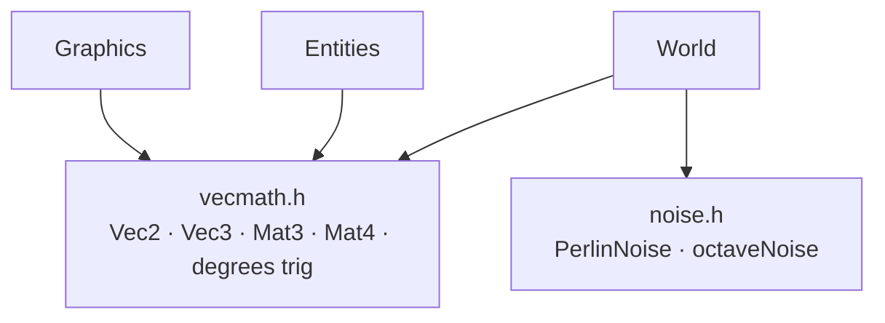

# Foundation

The header-only utilities everything else builds on. No dependencies of their
own; included across graphics, world, and entities.

## Responsibilities

- **vecmath.h** — `Vec2`/`Vec3` with the usual operators, `Mat3` (row-major 2D
  affine; the camera and renderer transform stack run on it) and `Mat4`
  (column-major, perspective/lookAt — present for future 3D). Crucially it
  defines the **degrees-based trig** (`sind`, `cosd`, `atan2d`, `acosd`,
  `DEG2RAD`) and the +y-down convention that let the p5.js port keep its angle
  math one-to-one.
- **noise.h** — a self-contained, seedable `PerlinNoise` with a permutation
  table and `octaveNoise(x, y, octaves, persistence)`. The [Planet](world.md)
  uses it to shape the star-shaped terrain silhouette.

## Source

- [src/math/vecmath.h](../../src/math/vecmath.h) — vectors, matrices, and
  degrees-based trig helpers.
- [src/math/noise.h](../../src/math/noise.h) — seedable Perlin/octave noise.

## Related

- The planet silhouette this noise seeds: [world](world.md).
- The transforms `Mat3` powers: [graphics](graphics.md), [core](core.md).
