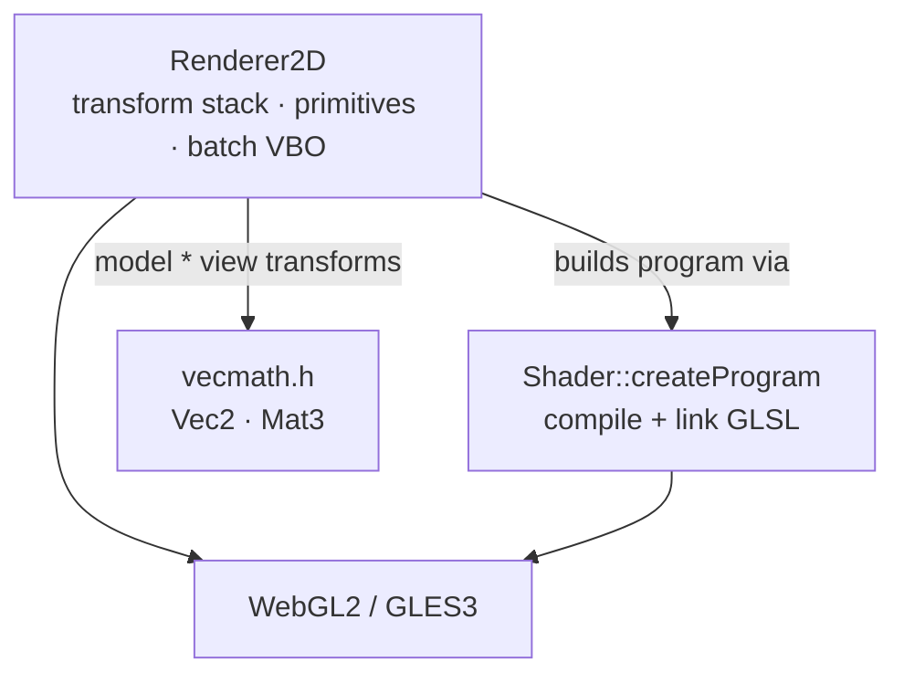

# Graphics

A thin 2D drawing layer that lets the ported game code read like its p5.js
original: set a fill, push/translate/rotate/scale, emit shapes. Geometry is
transformed on the CPU and batched; the trivial GL shader just draws the batch.
(The *fullscreen* post-process shaders — atmosphere, clouds, terminator — are
defined in the [core](core.md), not here; this layer only supplies the
compile helper they use.)

## Responsibilities

- **Renderer2D** — immediate-mode batcher. A `Mat3` transform stack
  (`push/pop/translate/rotate/scale`) mirrors p5; primitives (`triangle`, `quad`,
  `circle`, `ellipse`, `line`, `fanPolygon`, `convexPolygon`, per-vertex
  `triangleV`, textured `sprite`) emit CPU-transformed vertices into one
  interleaved dynamic VBO. The batch flushes when the blend mode changes
  (`Normal`/`Additive`) or at frame end. `begin(view,...)` maps world→clip with
  +y down; `beginScreenSpace()` emits directly in clip space for the starfield.
- **Shader** — a tiny namespace: `compile()` a stage and `createProgram()` to
  link a vert+frag pair. Used by the renderer for its batch shader and by the
  core for every fullscreen pass.

## Source

- [src/graphics/renderer2d.h](../../src/graphics/renderer2d.h) ·
  [renderer2d.cpp](../../src/graphics/renderer2d.cpp) — the immediate-mode
  batching renderer and its drawing primitives.
- [src/graphics/shader.h](../../src/graphics/shader.h) ·
  [shader.cpp](../../src/graphics/shader.cpp) — GLSL compile/link helper.

## Related

- The fullscreen shader passes that use `Shader::createProgram`: [core](core.md).
- The `Vec2`/`Mat3` math the transforms are built on: [foundation](foundation.md).
