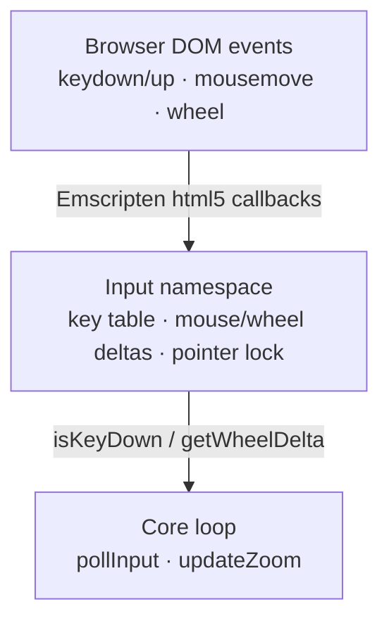

# Input

A small browser-event bridge. It registers Emscripten DOM callbacks on the
canvas and exposes a pollable snapshot, so the game loop can ask
"is W down this frame?" without dealing with event plumbing.

## Responsibilities

- **Init** — `Input::init("#canvas")` wires Emscripten `html5` key/mouse/wheel
  callbacks and defines the `Key` enum (WASD, arrows, space, E, etc.).
- **Poll state** — `isKeyDown(code)` for held keys; `getWheelDelta` +
  `resetWheelDelta` feed the camera's manual zoom; `getMouseX/Y` (canvas
  pixels) and `isMouseDown` (primary button, pressed on the canvas; released
  anywhere in the window) aim and fire the mining laser. The core loop reads
  these each frame in `pollInput`, `pollInputAstronaut`, `updateZoom` and
  `updateLaser`. (`getMouseDeltaX/Y` / `isPointerLocked` are stubs kept for
  API stability.)

## Source

- [src/input/input.h](../../src/input/input.h) ·
  [input.cpp](../../src/input/input.cpp) — the Emscripten input bridge and key
  codes.

## Related

- Who polls it each frame: [core](core.md), [frame loop](../flows/frame-loop.md).
