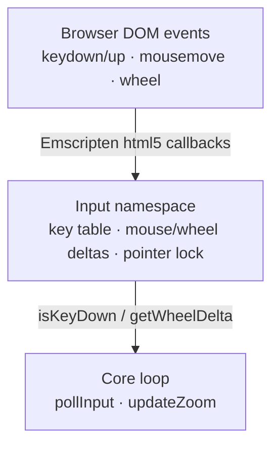

# Input

A small browser-event bridge. It registers Emscripten DOM callbacks on the
canvas and exposes a pollable snapshot, so the game loop can ask
"is W down this frame?" without dealing with event plumbing.

## Responsibilities

- **Init** — `Input::init("#canvas")` wires Emscripten `html5` key/mouse/wheel
  callbacks and defines the `Key` enum (WASD, arrows, space, E, etc.).
- **Poll state** — `isKeyDown(code)` for held keys; `getWheelDelta` +
  `resetWheelDelta` feed the camera's manual zoom; `getMouseX/Y` (canvas
  pixels) and `isMouseDown` (primary button, pressed on the canvas; released
  anywhere in the window) aim and fire the mining laser; `takeClick`
  (latched, so a click shorter than a frame still counts) swings the light
  sword once per click. `isRightMouseDown` / `takeRightClick` track the
  secondary button, kept for interacting with things (chests, later; unused
  so far — the page turns off the canvas's context menu). The core loop reads these each frame
  in `pollInput`, `pollInputAstronaut`, `updateZoom`, `updateAimStick`,
  `updateSword` and `updateLaser`. (`getMouseDeltaX/Y` / `isPointerLocked` are stubs kept for
  API stability.)
- **Touch** — phones and tablets have no keyboard or mouse, so the page
  (shell.html, `body.touch`: a coarse pointer, or `?touch` to force it) lays
  a gamepad over the game. Upright, a full-screen card asks you to turn the
  phone sideways; Play goes full screen and locks landscape where the browser
  allows (Android).
  - **Left stick** (moves): the thumb comes down anywhere in the lower left
    and that is the stick's middle. Past a threshold a direction is its key —
    A / D, W (thrust, or jump), S (dive) — pressed through the exported
    `inputKey(code, down)` (each press held at least 110 ms so a quick flick
    still lands on a frame). `inputStick(x, y)` also says how far it is
    pushed (`Input::stickX/Y`): the ship turns by that, so a small push is a
    slow turn; on foot, up held on once you are off the ground is the jetpack
    (after a beat: a flick is only a jump).
  - **Right stick** (aims, on foot): `inputAim(x, y, held)` gives its
    direction on screen (`Input::aimX/Y/aimHeld`). `updateAimStick` in
    main.cpp turns that into a pointer of the game's own each frame
    (`Input::setPointer`), so the tools read one mouse either way: pushed a
    little it only aims (a mark shows what the tool would reach), pushed past
    `AIM_FIRE` it fires. The laser takes the nearest thing to mine along the
    line, the cutter runs at full reach and snaps to level and plumb, the
    sword cuts that way and again as each cut ends.
  - **Buttons** hold a key while pressed: in the ship a big Thrust where the
    aim stick rests, Beam, and Out once landed; on foot Tool (it names the
    tool in hand) and Use; Rescue (R) when crashed or out of fuel. A row
    along the top has the rest (Flare, Scan, Breathe, Warp, Map, Bag, zoom).
  - A finger on the world is still the mouse (`inputPointer(x, y, phase)`:
    aim, fire, swing) and two fingers on it pinch the zoom (`inputWheel`,
    wheel units); a thumb on a stick or a button is not part of a pinch.
  - The pad follows the HUD's mode (fly / land / foot) and gives way to a
    close button while the inventory or a trade is open; the HUD shrinks to a
    corner and drops its keyboard hints.

## Source

- [src/input/input.h](../../src/input/input.h) ·
  [input.cpp](../../src/input/input.cpp) — the Emscripten input bridge and key
  codes.

## Related

- Who polls it each frame: [core](core.md), [frame loop](../flows/frame-loop.md).
