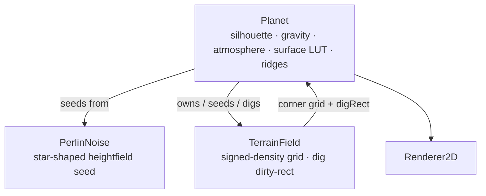

# World

The solar system. Each `Planet` owns its procedural silhouette, gravity,
atmosphere, background ridge layers, and an optional kinematic orbit around a
parent body (the moon circles home; the sun itself orbits home at the old
day-cycle rate so the tuned terminator drift carries over). `TerrainField` is
the destructible crust, a signed-density grid that digging carves — and it is
**lazy**: only the planet the player is near keeps a live grid
(`ensureField`/`releaseField`), with dig ops recorded in planet-local coords
and replayed on reload. Rendering samples the grid on the GPU (the core mirrors
it into an R16F texture for the body shader pass); far planets render from
their silhouette LUT rows instead.

## Responsibilities

- **Planet** — generates a star-shaped terrain silhouette (radius varies with
  angle via Perlin noise plus a couple of "mountain range" clusters), a 1/r²
  gravity field (`setDensity` sets the GM term), and a soft atmosphere shell
  (`atmosphereOuterRadius()`). Gameplay reads `surfaceRadius(angle)` from a fast
  CPU `surfaceLUT` rebuilt from the destructible field, so collision, landing,
  and the shader silhouette all reflect dug craters. `dig()` forwards into the
  field then rebuilds the LUT. A starter planet is ~32000 units across.
- **TerrainField** — a 2D signed-density grid in world space, organized around
  the planet centre. Each corner stores density (>0 solid rock, <0 open/cave,
  0-isoline = surface), seeded from the planet heightfield. It is the source of
  truth for collision (`solidAt`) and the silhouette (`outerSurfaceRadius`);
  rendering happens GPU-side from a texture mirror of `corners()`. `dig()`
  pushes corner densities negative inside a circular brush (never below the
  protected core) and reports the touched corner bounds via `digRect()` so the
  core re-uploads only that texture sub-rect.
- **Perlin noise** — supplies the octave noise that shapes the silhouette (from
  [foundation](foundation.md)).

## Source

- [src/world/planet.h](../../src/world/planet.h) ·
  [planet.cpp](../../src/world/planet.cpp) — procedural generation, gravity,
  atmosphere, the surface-radius LUT, and `dig()`.
- [src/world/terrain_field.h](../../src/world/terrain_field.h) ·
  [terrain_field.cpp](../../src/world/terrain_field.cpp) — the destructible
  density grid, collision sampling, and the dig dirty-rect.

## Related

- The noise primitive that seeds the silhouette: [foundation](foundation.md).
- Who reads gravity/surface and who digs: [entities](entities.md).
- How the field texture + silhouette LUT reach the GPU each change: [core](core.md).
