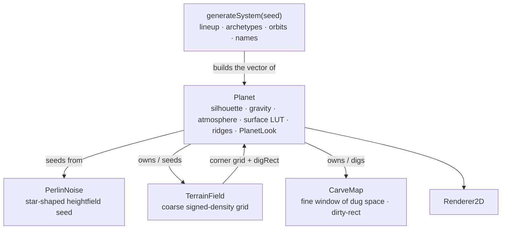

# World

The solar system is **generated**: `generateSystem(seed)` in
[system_gen.cpp](../../src/world/system_gen.cpp) turns one seed into a star,
four to six planets and a handful of moons. Each `Planet` owns its procedural
silhouette, gravity, atmosphere, background ridge layers, a `PlanetLook`
(palette, sky, clouds, haze) and a kinematic circular orbit around its parent —
planets around the star, moons around planets. Orbit rates are Kepler-consistent
with the parent's mass, so a ship coasting beside a planet shares its orbit.
Planets do not spin: a world's day is its year, and the lit side always faces
the star. `TerrainField` is
the crust at large scale, a coarse signed-density grid — and it is **lazy**:
only the planet the player is near keeps a live grid
(`ensureField`/`releaseField`). Digging lives in a second, fine layer,
`CarveMap`: a small high-resolution window around the player holding only what
has been cut away, rebuilt from the planet's list of bites whenever the player
moves on. The rock that is actually there is the minimum of the two
(`Planet::rockAt`). Rendering samples both grids on the GPU (the core mirrors
them into R16F textures for the body shader pass); far planets render from
their silhouette LUT rows instead.

## Responsibilities

- **System generator** — `generateSystem(seed, planets)` decides the lineup
  (planet count, whether there is a world inside the home orbit, which planets
  have moons), assigns each slot an **archetype** by distance from the star
  (scorched inside the home orbit, frozen at the edge; no kind repeats while
  unused kinds remain, bare rock excepted), sizes it, and lays out orbit radii
  so neighbors' moon systems never overlap. The archetypes are Temperate,
  Desert, Ice, Volcanic, Jungle, Exotic (fully hue-driven) and Barren
  (airless, cratered). Each fills in a `PlanetLook` — five terrain tones, sky
  scatter colors, haze, cloud cover/colors, ridge tints, foreground tint,
  ground-clutter mix — plus a `TerrainStyle` (range count/height, hill
  frequency, craters) and surface gravity. The **home world is always
  Temperate with the original tuning** (radius 32000, g 0.1, the hand-tuned
  look, one moon at 112000), so the starting planet feels the same in every
  system. The star's mass is derived from the home world's orbital speed
  (54–62 units/frame → a home day of roughly ten minutes). Names come from a
  syllable generator. The shaders handle 10 bodies including the star; moons
  are trimmed from the outside in if a lineup exceeds that.
- **Seed** — chosen by the host page: `?seed=N` in the URL, else the seed
  remembered in `localStorage` (reloading returns you to the same system), else
  random. Published as `window.GAME_SEED` before the wasm starts.
- **Planet** — generates a star-shaped terrain silhouette (radius varies with
  angle via Perlin noise plus a couple of "mountain range" clusters), a 1/r²
  gravity field (`setDensity` sets the GM term), and a soft atmosphere shell
  (`atmosphereOuterRadius()`). The ship, the cows and the shader silhouette
  read `surfaceRadius(angle)` from a fast CPU `surfaceLUT` (the terrain's
  outline, marched out of the field: 8192 entries, each the grid's exact 0
  crossing on its ray, so it stays within a unit or two of the ground the
  shader draws from that grid — plants, cows, shadows and the ship are all
  placed by it). `rockAt(world)` is the finer question —
  "is there rock at this exact point?" — the terrain minus everything dug, and
  `normalAt` its surface normal; the astronaut collides with that, and the
  cutter aims with it. `dig()` records a bite and cuts it into the carve
  window; `focusCarve()` keeps that window around the player. A starter planet
  is ~32000 units across.
  **Mesas and natural caves.** Every rocky body gets flat-topped raised areas
  (about one per 9000 units of ground, 110–230 tall, 1000–2000 across; never
  in mountain ranges, and the home world's drop-in point is kept clear) added
  to the silhouette analytically (`mesaOffset`), so the field, collision and
  landing see them. Most get a cave system, built once by `buildCaves()`
  ([cave_gen.cpp](../../src/world/cave_gen.cpp)) when the field first loads:
  a flared mouth in a flank, a gallery in to a tall hall under the top
  (sometimes a skylight shaft out through it, sometimes a second gallery out
  the far flank), then a ramp — or a well in the hall's floor — down to a big
  cavern well below ground, with crystal grottos through low crawls and
  sometimes a deeper geode room. Each piece is described by its floor and cut
  as bites standing on it, at the front of the same dig list the cutter
  appends to — so caves collide, draw and cut away exactly like dug tunnels,
  floors stay walkable under lumpy ceilings, and you walk in from outside.
  The same pass furnishes them (`Planet::caveProps`, see CaveField below),
  records where they break the surface (`caveMouths`, for the shader's
  natural rims) and retires surface plants standing over an opening (marked
  gone, not erased, so indices into the list stay valid). While flying
  below 1500 the carve window follows the ship so mouths show on approach.
  `updateOrbit` advances the circular orbit and publishes both the world
  velocity (`orbitVel`, analytic — valid on the first frame, which is what
  lets a freshly spawned ship start co-moving) and the exact displacement this
  frame (`orbitStep`, what things standing on the surface are carried by).
  `applyGlobalDensity` applies the debug gravity knob to every body while
  preserving each one's relative density (and the star's mass ratio).
- **Water** — a wet world has ONE water level (`Planet::seaLevel`, above
  the base radius; `seaRadius()` is the surface as a circle round the
  center). `generate()` sets it where a chosen share of the ground lies
  below it, so the terrain's own low ground fills into a handful of ponds,
  lakes and seas of whatever size it offers (typically five to ten bodies,
  a few hundred to fifteen thousand units across, up to a few hundred
  deep). The share comes from the archetype (`TerrainStyle::seaChance` /
  `seaMin` / `seaMax`): temperate about a fifth, jungle a quarter to a
  third, ice a tenth to a fifth, exotic worlds some liquid or other about
  two times in three, desert the odd waterhole, volcanic and airless
  worlds none; the colors are `PlanetLook::water` / `waterDeep`. It is
  drawn from the planet's own seed with its own RNG, so dry worlds — and
  everything else about wet ones — generate exactly as they did. Three
  things are fitted to it: the home world's drop-in point is raised clear
  of the water where it would have been awash (the rise slopes back down
  into it as a shore); mesas keep off wet ground, so the caves in their
  flanks open dry; and nothing is planted under water. `visibleRadius()`
  is the ground as seen from above — terrain, or the water over it — which
  is what the ship comes down on and shadows fall on. `waterDepth(point)`
  says how far under the surface a point is *if it is in water*: in the
  sea (open, above the ground, under the level), or in dug space the water
  has got into. **Flooding.** A hole is dry until it connects to water:
  `CarveMap` marks the dug samples that lie below the level and touch
  water — the sea, or an already-flooded neighbor — and carries on along
  the tunnel from there (`flood`, run over the block each bite changes;
  water only ever gains ground, so nothing is recomputed). So a shaft sunk
  beside a lake stays dry however deep, one cut in the lake bed fills as it
  is cut, and a tunnel that breaks through into the lake floods at once,
  back to its far end and up any shaft to the level. Each bite remembers
  that it flooded (`Op::wet`), so a flooded tunnel is still flooded when
  the window is rebuilt somewhere its link to the sea is out of sight. The
  flooded samples are mirrored to the GPU (`wet()`, an R8 texture) for the
  water shader. The level is a debug knob too (`waterLevel`: raise or
  lower every sea; the dig window is re-flooded when it moves).
- **Cave field** ([cavefield.cpp](../../src/world/cavefield.cpp)) — what
  grows in the natural caves: stalactites, stalagmites, columns (calcite),
  glowing crystal clusters (the world's crystal), glowcap mushrooms (grow
  back), gold veins in the deep rooms, and the rubble round each mouth
  (ferrite). Each prop is rooted at a physical point on the rock with the
  direction it grows; it is drawn `WALK_DROP` lower like everything on the
  walking line, never collides, and stands behind or in front of the walker.
  The calcite formations grow out of the wall: they are drawn clipped to the
  cave's open space (a stencil mask from the body pass, `drawCaveMask`), so
  the rock hides their roots.
  One module owns where a prop is as drawn, so drawing, picking (with a
  line-of-sight test through `rockAt`) and the laser agree. Interior props
  fade in only for a player who is underground; the front-ground veil hides
  the rest. `lights()` hands the nearest glowing props to the body shader,
  which lights the cave's back wall and rim with them (plus the player's
  lamp), soft-capped so a crowded room pools instead of whiting out. The
  back wall is the hole rule (the body shader's `holeShade`: the ground's
  own banded tone in the hour's light, darker with depth, levelling off at
  `holeFloor` from `holeDepth` down); formations follow it — their two tones
  come from `Planet::groundTone` (a CPU twin of the shader's banding) at the
  prop, times the light and the same shade, stepped up ~1.6x / ~2.2x so both
  faces sit above the wall. Crystals, glowcaps and gold are emitted light and
  keep their own colors.
- **Buried ore** ([deposits.cpp](../../src/world/deposits.cpp)) — clumps of
  ferrite, the world's crystal and gold through the rock of every rocky
  world, invisible until digging exposes them. They are seeded on a grid of
  150-unit squares (planet-local): each square holds a short vein of 1–5
  clumps or nothing, worked out from the planet's seed and the square alone
  whenever something asks — nothing is generated up front, and a planet
  stores only the clumps found so far (`Planet::ores`) and the ids it has
  looked at (`Planet::oreSeen`; -1 = a cave hollowed it out). A vein's kind
  follows its depth below the ground line — ferrite from a little way down,
  the crystal from ~80, gold from ~150 and more of it deeper — weighted by
  the kind of world (volcanic leans gold, ice crystal, barren ferrite);
  stretches of ground a few hundred strides long are rich or barren, and
  `oreRichness` (debug panel) scales it all. The default (`BASE_CHANCE`)
  was tuned with a headless run of straight tunnels: a vein every ~8–15 s
  of cutting, the first within a few seconds; shallower than ~100 a little
  sparser. A clump stops the cutter (see core.md), so tunnelling halts
  at one and leaves it in the wall. A clump holds as many pieces as it
  yields (`pieces`: 2–3 gold nuggets, 2–4 ferrite cubes, 3–4 crystal
  shards, laid out by `layout`), and the mining laser takes them one at a
  time (`taken`, from `Ore::hp`, which never recovers); with the last it
  digs the clump's pocket, `POCKET` wider than it was, and a vein's clumps
  sit just close enough that the pocket shows the next. The cutter held on
  a clump destroys it instead: `Ore::heat` rises to 1 over `burnSeconds`
  (toughness x the `oreBurn` knob) and the clump is taken out the same way
  with nothing collected; heat cools at 0.45/s once the cutter is off it. When the carve window is
  rebuilt (`scanWindow`) the clumps a cave's walls already run past are
  revealed, so caves show some ore from the start. Clumps are drawn like
  the caves' contents: `WALK_DROP` lower, only for a player underground.
- **Near field** ([nearfield.cpp](../../src/world/nearfield.cpp)) — the strip
  of ground around the walking line and the **harvestables** standing on it
  (`Planet::harvest`: grass, bulb plants, crystals, rocks; what grows and how
  thickly comes from the look's `flora` / `mineral` colors and densities, so
  an airless moon has only ore). They are placed the way they would grow
  (`Planet::growHarvest`, [harvest_gen.cpp](../../src/world/harvest_gen.cpp)):
  in clumps — a patch of grass tallest in the middle, often with bulbs in it;
  a boulder with its scatter of stones; a big crystal with small ones at its
  foot — on ground that suits them (plants on damp, level, low ground, by a
  slow moisture noise and the terrain's slope, height and hollows; stone on
  slopes, high ground, mineral-rich stretches and at the foot of mesas), with
  loners between and a straggler wherever more than ~520 units would be left
  bare. The list is sorted by angle and searched (any spacing). Each has a `depth`: how far in front of (+)
  or behind (−) the walking line it stands. The module turns depth into a
  screen position (0.64 of the depth down the screen — the same ~40° ground
  view as the blob shadows), a size, a tone and a draw order (no parallax:
  items stay rooted to the ground they stand on);
  `base()/center()/radius()` are the single source of truth used by drawing,
  cursor picking and the laser's end point. It also owns the harvest rules
  (`yield`, `toughness`) and regrowth (`update`), and the numbers that place
  a dug hole in that same ground: `WALK_DROP` (how far below the terrain line
  the walking line is drawn — and therefore holes), the shape of a hole's
  mouth (`MOUTH`, `MOUTH_RISE`, `MOUTH_ROUND`) and how far the front strip
  reaches (`FRONT_DEPTH`).
- **The locals and their trading posts**
  ([outposts.cpp](../../src/world/outposts.cpp)) — every world has people of
  its own. `Planet::foundOutposts` (the last step of `generate()`) draws one
  **kind** per world from its seed (`Planet::Folk`: skin color — any hue but
  the ground's or the world's crystal color — height, girth, one to three
  eyes, one of three body plans: a one-piece gumdrop, a head on a neck, a
  low dome with its eyes on stalks; antennae; a glass bubble helmet where
  there is no air) and places their **posts** (`Planet::outposts`): about
  one per 50,000 units of ground, one to a sector round the world, each on
  the most level ground a couple of dozen looks turn up that is dry, clear
  of mesas (and so of caves) and well apart from the others. The home
  world's first post is always a short walk — 700 to 1500 units — from
  where the ship drops in. Every world gets at least one. Plants and stones
  are cleared off the ground a post stands on. A post is a domed hut, a
  market stall with the **trader** behind its counter, a mast with a
  lantern, a crate and a pot, standing on the strip of ground just behind
  the walking line (so the ship and the astronaut pass in front), and one
  to three more locals who wander the ground either side of it
  (`Planet::Alien`). `Outposts::update` is their day: wanderers amble to a
  spot on their stretch, stand, pick another; anyone you walk right up to
  stops and turns to look; the trader faces you from further off and waves
  when you first arrive. `Outposts::draw` draws it all in the hour's light
  (each piece rooted at its own angle, on the lowest ground under it, no
  parallax); `nearest` / `inReach` are what the HUD pointer and the E key
  ask; `blocksDig` keeps the cutter `NO_DIG` units away, because a post
  stands on the terrain's outline like the ship and would be left hanging
  over a hole. What a post pays and sells is not here: see
  [core](core.md) (`trade.cpp`).
- **TerrainField** — a 2D signed-density grid in world space, organized around
  the planet centre. Each corner stores density (>0 solid rock, <0 open/cave,
  0-isoline = surface), seeded from the planet heightfield. It is the source of
  truth for the silhouette (`outerSurfaceRadius`) and the large-scale shape;
  rendering happens GPU-side from a texture mirror of `corners()`. It is never
  edited: its cells are 250 units, far larger than a person.
- **CarveMap** — digging at the scale of a person. A 512×512 window of
  samples 6 units apart (about 3000 units across) around the player. In rock
  a sample is the distance to the nearest dug space; in open space near a
  hole (dug, or the sky over its mouth) it is minus the distance to the
  nearest *real* rock (neither dug nor sky). That second part matters for
  collision: the raw "min over bites" depth shrinks to a few units where two
  bites barely overlap and counts the air just above a mouth as rock, which
  put invisible floors and lids in holes (a shaft cut up from below could not
  be climbed out of). `apply()` cuts one circular bite, recomputes the open
  distances around it, and reports the samples that changed (the core
  re-uploads only that texture sub-rect); `recenter()` moves the window and
  rebuilds it from the planet's full list of bites, so holes persist wherever
  they are. Stored planet-local, so it rides the planet's orbit.
- **Perlin noise** — supplies the octave noise that shapes the silhouette (from
  [foundation](foundation.md)).

## Source

- [src/world/system_gen.h](../../src/world/system_gen.h) ·
  [system_gen.cpp](../../src/world/system_gen.cpp) — seed → star system:
  lineup, archetypes (`applyArchetype`), orbit layout, names.
- [src/world/planet.h](../../src/world/planet.h) ·
  [planet.cpp](../../src/world/planet.cpp) — `PlanetLook` / `TerrainStyle`,
  procedural generation, gravity, orbits, atmosphere, the surface-radius LUT,
  and `dig()`.
- [src/world/cave_gen.cpp](../../src/world/cave_gen.cpp) — `buildCaves`:
  cave layout, furnishing, mouths.
- [src/world/cavefield.h](../../src/world/cavefield.h) ·
  [cavefield.cpp](../../src/world/cavefield.cpp) — cave props: drawing,
  picking, mining rules, lights.
- [src/world/deposits.h](../../src/world/deposits.h) ·
  [deposits.cpp](../../src/world/deposits.cpp) — buried ore: the seeding
  grid, revealing, the cutter's rule, picking, mining, drawing.
- [src/world/harvest_gen.cpp](../../src/world/harvest_gen.cpp) —
  `growHarvest`: where the plants and minerals grow.
- [src/world/outposts.h](../../src/world/outposts.h) ·
  [outposts.cpp](../../src/world/outposts.cpp) — the locals and their
  trading posts: the per-world kind, placement, their daily life, drawing,
  reach and the no-dig zone.
- [src/world/nearfield.h](../../src/world/nearfield.h) ·
  [nearfield.cpp](../../src/world/nearfield.cpp) — harvestables in depth:
  placement on screen, drawing, picking, harvest rules, regrowth.
- [src/world/terrain_field.h](../../src/world/terrain_field.h) ·
  [terrain_field.cpp](../../src/world/terrain_field.cpp) — the coarse density
  grid and the silhouette march.
- [src/world/carve_map.h](../../src/world/carve_map.h) ·
  [carve_map.cpp](../../src/world/carve_map.cpp) — the fine dig layer.

## Related

- The noise primitive that seeds the silhouette: [foundation](foundation.md).
- Who reads gravity/surface and who digs: [entities](entities.md).
- How the field texture + silhouette LUT reach the GPU each change: [core](core.md).
