# The frame loop

`mainLoop()` runs once per animation frame (driven by
`emscripten_set_main_loop`). It splits into an **update** half (advance the
simulation by a frame-relative `timeScale`) and a **render** half (draw the
scene in strict back-to-front layers so the sky correctly occludes stars and the
night side darkens before clouds go on top). Source:
[main.cpp](../../src/core/main.cpp).

## Update phase

```mermaid
sequenceDiagram
    participant Loop as mainLoop
    participant JS as window.DBG (shell.html)
    participant In as Input
    participant L as Lander
    participant P as Planet
    participant Cows as Cow herd
    participant A as Astronaut
    participant V as View

    Loop->>JS: syncDebugFromJS() — pull live tunables into gDebug
    Loop->>In: read edge keys (E enter/exit, R restart, thrust liftoff)
    alt state == PLAYING
        Loop->>In: pollInput()
        Loop->>L: update(planet, timeScale) — gravity, thrust, drag
        Loop->>P: updateContact() — land? crash?
        Loop->>L: updateBeam(planet) — build tractor cone
        Loop->>Cows: runBeamGrab() + cow.update() → cargo/score
    else state == LANDED
        Loop->>L: stick to body; thrust key → liftOff()
    else state == CRASHED
        Loop->>L: R key → resetGame()
    end
    opt spacewalking
        Loop->>In: pollInputAstronaut() (walk/jump/jetpack/dig)
        Loop->>A: update(planet, timeScale)
    end
    Loop->>V: updateZoom() + updateView() — framing, follow, auto-roll
```

## Render phase

Drawn in this order so each layer composites correctly over the last:

```mermaid
flowchart LR
    Clear["glClear + view matrix"] --> Stars["1. Starfield<br/>(screen-space)"]
    Stars --> Ridges["1b. Ridge silhouettes<br/>hazy horizon layers"]
    Ridges --> Terrain["2. Planet body pass<br/>SDF fill · material · slope light · terminator"]
    Terrain --> Cows["2b. Ground shadows + cows"]
    Cows --> Atmo["3. Atmosphere disk<br/>Rayleigh/Mie, occludes stars"]
    Atmo --> Ship["3c. Ship + astronaut<br/>+ trajectory/beacon aids"]
    Ship --> Clouds["4. Clouds<br/>FBM band, in front of all"]
    Clouds --> HUD["updateHUD() → DOM overlay"]

    click Stars call navigate("../../src/core/main.cpp")
    click Ridges call navigate("../../src/core/main.cpp")
    click Terrain call navigate("../../src/core/main.cpp")
    click Cows call navigate("../../src/entities/cow.cpp")
    click Atmo call navigate("../../src/core/main.cpp")
    click Ship call navigate("../../src/entities/lander.cpp")
    click Clouds call navigate("../../src/core/main.cpp")
    click HUD call navigate("../../shell.html")
```



Key ordering reasons (from the comments in `mainLoop`):

- **Ridge silhouettes** draw before the body pass, so only peaks poking above
  the main silhouette stay visible as distant horizon mountains.
- The **body pass** (one fullscreen draw) fills the rock from the destructible
  density-field texture, applies the altitude-banded material, slope lighting
  from the SDF gradient, the day/night terminator, and the dark cave-interior
  backdrop. It runs *before* the cows so abductable cows stay readable at night.
- **Ground blob shadows** draw between the body and the entities, grounding the
  ship/astronaut/cows on the surface.
- The **atmosphere** is one disk drawn after the planet body; the shader splits
  it by radius (horizon sky above the mountains, altitude-gated sky sphere over
  the planet face), so the ground stays clear up close.
- **Clouds** draw last (in front of the ship) so you fly behind them. In space,
  a locator **beacon** + heading arrow overlay the sub-pixel ship.

## Files in this flow

- [src/core/main.cpp](../../src/core/main.cpp) — `mainLoop`, the state machine,
  the shader passes, and the draw ordering.
- [src/entities/lander.cpp](../../src/entities/lander.cpp),
  [cow.cpp](../../src/entities/cow.cpp),
  [astronaut.cpp](../../src/entities/astronaut.cpp) — the actors updated/drawn.
- [src/world/planet.cpp](../../src/world/planet.cpp) — gravity, surface, dig.
- [src/input/input.cpp](../../src/input/input.cpp) — the polled key/wheel state.
- [shell.html](../../shell.html) — the HUD overlay updated each frame.

## Related

- Subsystem map: [overview](../overview.md).
- The orchestrator that owns this loop: [core](../architecture/core.md).
