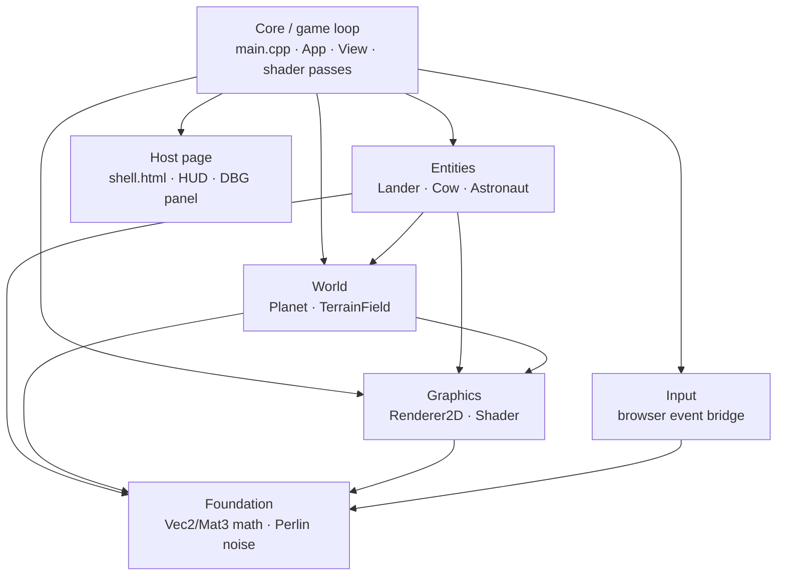

# Cow Abductor — Architecture Overview

A 2D arcade game compiled from C++ to WebAssembly and rendered with WebGL 2
(OpenGL ES 3.0) through Emscripten. You pilot a lander around a huge,
procedurally generated, **destructible** planet, tractor-beam cows into your
hold, and can step out as a jetpack astronaut to dig the crust. The look —
Rayleigh/Mie atmosphere, drifting clouds, a day/night terminator — comes from
fullscreen shader passes layered over an immediate-mode 2D renderer.

It is a faithful port of the original p5.js "cow-abductor" sketch; the math and
tuning constants carry over one-to-one (degrees-based trig, +y-down world).

## Subsystems

Each node links to the architecture doc for that subsystem. The per-frame
ordering of updates and draw passes — the part that ties them together — is its
own flow:

- [The frame loop](flows/frame-loop.md) — what `mainLoop()` does each tick:
  input → physics → camera, then the layered render (stars → terrain →
  terminator → cows → atmosphere → ship → clouds) and the HUD push.

## Architecture docs

- [Core / game loop](architecture/core.md) — the `App` singleton, the
  `PLAYING/LANDED/CRASHED` state machine, the `View` camera, and the fullscreen
  shader passes (atmosphere, clouds, terminator, terrain mesh) defined inline in
  `main.cpp`.
- [Entities](architecture/entities.md) — the player [Lander](../src/entities/lander.h),
  the abductable [Cow](../src/entities/cow.h), and the spacewalking
  [Astronaut](../src/entities/astronaut.h).
- [World](architecture/world.md) — the procedural [Planet](../src/world/planet.h)
  and its destructible [TerrainField](../src/world/terrain_field.h) crust.
- [Graphics](architecture/graphics.md) — the immediate-mode
  [Renderer2D](../src/graphics/renderer2d.h) batcher and the
  [Shader](../src/graphics/shader.h) compile helper.
- [Input](architecture/input.md) — the [Input](../src/input/input.h) namespace
  bridging Emscripten DOM key/mouse/wheel events into a pollable state.
- [Foundation](architecture/foundation.md) — shared math
  ([vecmath.h](../src/math/vecmath.h): `Vec2`, `Mat3`, degrees trig) and
  [Perlin noise](../src/math/noise.h).

## Conventions & host page

- **Coordinate system** — world is a 2D plane with **+y pointing down** on
  screen, matching p5.js. All trig is **degrees-based** (`sind`/`cosd`/`atan2d`
  in [vecmath.h](../src/math/vecmath.h)) so ported angle math is unchanged.
- **Live tunables** — [debug.h](../src/core/debug.h) defines a `gDebug` struct
  of in-game knobs (thrust, atmosphere/cloud params, camera framing). The HTML
  debug panel in [shell.html](../shell.html) owns the UI + `localStorage` and
  writes `window.DBG`; `syncDebugFromJS()` copies it into `gDebug` each frame.
- **Host page / HUD** — [shell.html](../shell.html) is the Emscripten shell: it
  hosts the `#canvas`, renders the fuel/score/altitude HUD (`window.updateHUD`,
  called from the C++ loop), and the debug slider panel.

## Building & running

- [build.sh](../build.sh) — primary build; compiles the source list through
  `emcc` with the WebGL2/ES3 flags and `shell.html`.
- [CMakeLists.txt](../CMakeLists.txt) — mirrors the same source list for an
  Emscripten CMake build.
- [README.md](../README.md) — project intro and setup notes.
