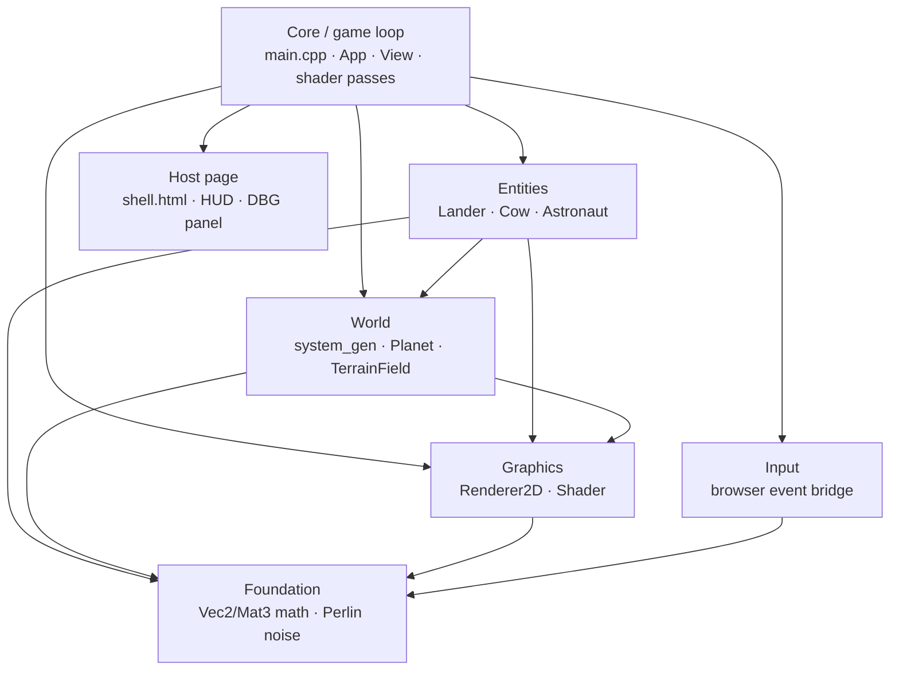

# Cow Abductor — Architecture Overview

A 2D arcade game compiled from C++ to WebAssembly and rendered with WebGL 2
(OpenGL ES 3.0) through Emscripten. You pilot a lander around a **generated
solar system** — one seed builds the star, the planets, their moons, looks and
names — of huge, **destructible** worlds: tractor-beam cows into your hold on
the home planet, step out as a jetpack astronaut to dig the crust and mine it,
sell what you find to the locals at their trading posts and buy upgrades from
them, then fly to the next world and chart it. The look —
Rayleigh/Mie atmosphere, drifting clouds, a day/night terminator — comes from
fullscreen shader passes layered over an immediate-mode 2D renderer.

It is a faithful port of the original p5.js "cow-abductor" sketch; the math and
tuning constants carry over one-to-one (degrees-based trig, +y-down world).

## Subsystems

Each node links to the architecture doc for that subsystem. The per-frame
ordering of updates and draw passes — the part that ties them together — is its
own flow:

- [The frame loop](flows/frame-loop.md) — what `mainLoop()` does each tick:
  input → physics → camera, then the layered render (stars → ridges → body
  pass → shadows/cows → atmosphere → ship → clouds) and the HUD push.

## Architecture docs

- [Core / game loop](architecture/core.md) — the `App` singleton, the
  `PLAYING/LANDED/CRASHED` state machine, the `View` camera, the fullscreen
  shader passes (planet body, atmosphere, clouds) defined inline in
  `main.cpp`, and trading ([trade.h](../src/core/trade.h): prices, goods,
  upgrades).
- [Entities](architecture/entities.md) — the player [Lander](../src/entities/lander.h),
  the abductable [Cow](../src/entities/cow.h), and the spacewalking
  [Astronaut](../src/entities/astronaut.h).
- [World](architecture/world.md) — the [system generator](../src/world/system_gen.h),
  the procedural [Planet](../src/world/planet.h) and its destructible
  [TerrainField](../src/world/terrain_field.h) crust, and each world's locals
  and their [trading posts](../src/world/outposts.h).
- [Graphics](architecture/graphics.md) — the immediate-mode
  [Renderer2D](../src/graphics/renderer2d.h) batcher and the
  [Shader](../src/graphics/shader.h) compile helper.
- [Input](architecture/input.md) — the [Input](../src/input/input.h) namespace
  bridging Emscripten DOM key/mouse/wheel events into a pollable state.
- [Foundation](architecture/foundation.md) — shared math
  ([vecmath.h](../src/math/vecmath.h): `Vec2`, `Mat3`, degrees trig) and
  [Perlin noise](../src/math/noise.h).

## Conventions & host page

- **Gameplay** — [gameplay.md](gameplay.md): what the player is trying to do
  (build the star drive and leave the system), the loop, the three walls
  (range, suit time, tool hardness), the equipment ladder, what every
  resource is for, what failing costs, and the order to build it in. Most of
  it is not built yet; every gameplay feature is checked against it.
- **Art style** — [art-style.md](art-style.md): limited palette, five flat
  terrain tones, three cel light steps, soft computed skies, flat ridge
  layers, and the 10-16% ground-ellipse rule. Every new visual feature follows
  it.

- **Coordinate system** — world is a 2D plane with **+y pointing down** on
  screen, matching p5.js. All trig is **degrees-based** (`sind`/`cosd`/`atan2d`
  in [vecmath.h](../src/math/vecmath.h)) so ported angle math is unchanged.
- **Live tunables** — [debug.h](../src/core/debug.h) defines a `gDebug` struct
  of in-game knobs (thrust, atmosphere/cloud params, camera framing). The HTML
  debug panel in [shell.html](../shell.html) owns the UI + `localStorage` and
  writes `window.DBG`; `syncDebugFromJS()` copies it into `gDebug` each frame.
- **Host page / HUD** — [shell.html](../shell.html) is the Emscripten shell: it
  picks the system seed (`?seed=N` → remembered → random), hosts the `#canvas`,
  renders the HUD — the ship's fuel, altitude and velocity while you fly it,
  the suit, pack and hand tool while you are on foot, plus the current world
  and chart progress (`window.updateHUD` / `updateNav`, called from the C++ loop), event
  banners, the map's name labels, and the debug panel (sliders, "New random
  system", per-world "Warp to" buttons).
- **Controls** — W/Up thrust, A/D rotate, Space tractor beam, E exit/enter the
  ship (and, on foot beside a trader's stall, trade), M system map, T time
  warp in open space, J jump (with a star drive), R rescue after a crash, wheel or +/- zoom, R restart after a crash. On foot:
  A/D walk (and steer in the air), W jump, Space jetpack, hold the mouse
  button to use the hand tool at the cursor, Q (or 1/2/3) to switch it
  between mining laser, terrain cutter (once bought) and light sword (each
  click a cut: crawlers come up after dark, bats wait in the caves), F breathe carbon into the suit, C
  scan for ore, Tab (or I) for the pack and the hold; online, Enter opens
  the transmissions box (a global chat for everyone on the server). The title screen asks
  for a name and has one button, Play, which goes online (alone if the
  server cannot be reached) and carries on from the save; the game saves
  itself (localStorage).
- **Multiplayer** — [server/](../server/) is a uWebSockets.js room server:
  one room per seed, a shared clock for the orbits, and an ordered log of
  every change to the world. See [core](architecture/core.md) (Multiplayer).

## Building & running

- [build.sh](../build.sh) — primary build; compiles the source list through
  `emcc` with the WebGL2/ES3 flags and `shell.html`.
- [CMakeLists.txt](../CMakeLists.txt) — mirrors the same source list for an
  Emscripten CMake build.
- [README.md](../README.md) — project intro and setup notes.
